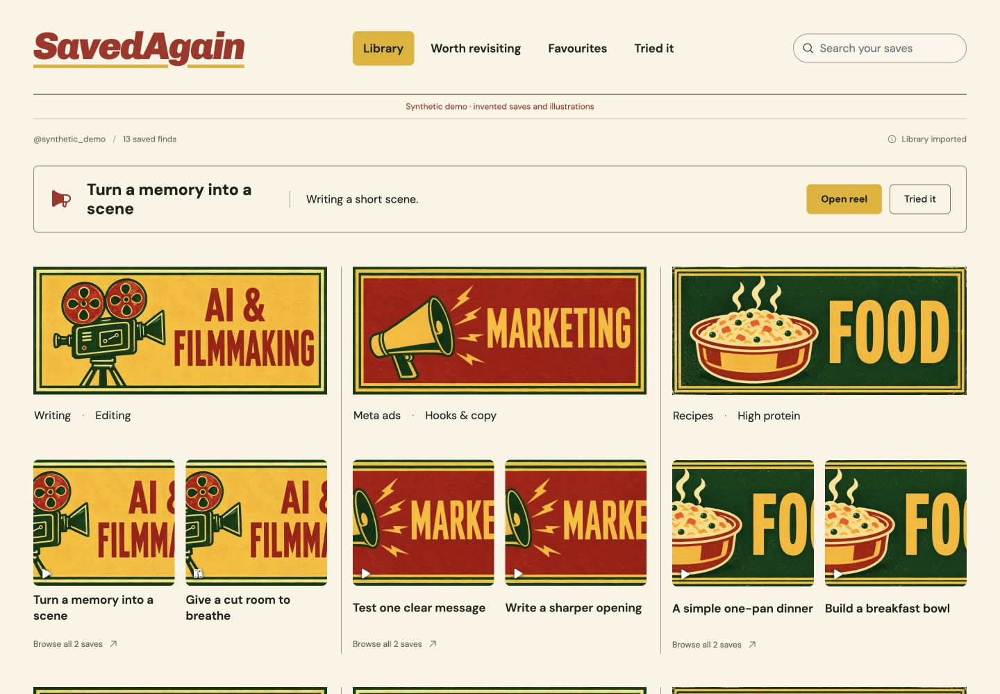
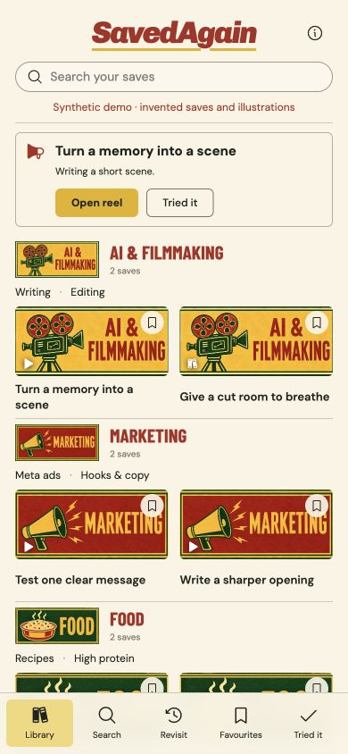

# SavedAgain

**You saved it for a reason. Find it when you need it.**

A personal Instagram Saved organizer, packaged as a portable agent skill **with its complete dashboard included**. Your assistant reads your saves through your logged-in browser and organizes them into a private Matchbox Collection: topics, subtopics, searchable references and a few useful reminders.

> **Independent personal project.** SavedAgain is not affiliated with, endorsed by or sponsored by Instagram or Meta. Users are responsible for complying with platform terms, privacy rules and the rights governing every item they process.

> **Free for personal, noncommercial use only.** This is source-available software, not OSI open source. Business use, paid hosting, resale and other commercial use require separate written permission. See [LICENSE](LICENSE).



## What you get

- A clean dashboard for laptop and phone, with original matchbox category artwork.
- Nested topics such as Filmmaking → Editing, Writing or Sound; Food → Recipes; Marketing → Meta ads. Create and rename your own categories.
- Search captions, titles, takeaways and tags; open the original post when you need it.
- Persistent notes, favourites, Tried it, snooze and category corrections.
- Browser imports that checkpoint every batch and preserve your edits when resumed.
- Local SQLite storage, cached original previews, JSON export and full backup/restore.
- Optional private analysis of user-provided reel files with OCR, scene sampling, local embeddings and VoiceStudio-only transcription.
- An optional always-available Cloudflare mirror with Access authentication, D1 metadata, private R2 previews and two-way edits.

There is no paid AI API requirement or automatic video download. Reminders appear inside the dashboard. This version organizes Instagram saved posts and reels; it does not import bookmarks or screenshots or schedule notifications.

## Requirements and compatibility

Use an assistant that supports the [Agent Skills format](https://agentskills.io/specification), can read bundled files, and can execute local commands. **Importing also requires supported browser tools connected to your logged-in Instagram session.** Merely installing the skill does not give an assistant access to Chrome. A public-URL browsing/search tool is insufficient for Saved.

Install Python 3.11+ and Node.js 24+ (with npm). The setup script checks prerequisites, builds a private app workspace and installs dependencies there. Your local browser must be able to reach the runtime's localhost. A remote chat sandbox cannot automatically reach your computer or Chrome profile.

The core instructions are tool-independent. macOS operation is tested; Windows-aware paths and Linux/Docker configurations are supplied. See [validation](docs/validation.md) for exact tested environments and limits. No claim of universal browser compatibility is made.

## Install the skill

Download the `saved-again-skill-1.1.0.zip` release and extract its `saved-again` folder into your assistant's skills directory, or copy the **entire** `skills/saved-again` folder from this repository. Do not install just SKILL.md: the bundled dashboard and management script are required.

Common locations are `~/.agents/skills/saved-again` for assistants that scan the shared convention and `~/.claude/skills/saved-again` for Claude Code. Check your assistant's own installation instructions; discovery and invocation syntax vary. Restart/reload its skill catalog if needed. Never replace an existing installed skill without reviewing the update.

Example requests:

> Use SavedAgain to organize my Instagram Saved library and open my dashboard.

> Resume my SavedAgain import from its checkpoint.

> Find three saved references that would help with my next edit.

The assistant checks its tools, starts the dashboard and confirms your Instagram account. If browser tools are unavailable or you are logged out, importing pauses until you connect/sign in. There is no manual link/caption import fallback.

For a reproducible source installation, clone a tagged release, verify the release checksums, keep the committed lockfiles unchanged, and run:

```sh
python3 skills/saved-again/scripts/savedagain.py doctor
python3 skills/saved-again/scripts/savedagain.py setup
python3 skills/saved-again/scripts/savedagain.py doctor --json
```

`doctor` checks the required Python/Node/npm toolchain and reports optional FFmpeg, VoiceStudio, local-model and cloud status without downloading anything or revealing secrets. Core Python packages, optional analyzer packages, npm packages and Wrangler are pinned. The offline [model manifest](skills/saved-again/references/models-manifest.json) pins immutable revisions/checksums where the upstream distributor exposes them.

## Run the dashboard directly

From the repository root, using a Python 3.11+ executable (`python3` here):

```sh
python3 skills/saved-again/scripts/savedagain.py setup
python3 skills/saved-again/scripts/savedagain.py start
python3 skills/saved-again/scripts/savedagain.py key
```

Open the URL printed by `start` and enter the locally generated key. On Windows use `py -3.11` or your Python 3.11+ executable instead of `python3`. The standalone app starts empty; importing still requires the browser workflow.

Defaults: `~/SavedAgain/app` for app/runtime files and `~/SavedAgain/library` for your private library. Choose another location with global options **before** the command:

```sh
python3 skills/saved-again/scripts/savedagain.py --workspace "MY WORKSPACE" setup
python3 skills/saved-again/scripts/savedagain.py --workspace "MY WORKSPACE" start --port 8765
python3 skills/saved-again/scripts/savedagain.py --workspace "MY WORKSPACE" status
python3 skills/saved-again/scripts/savedagain.py --workspace "MY WORKSPACE" stop
```

`--data PATH` chooses a separate library directory. `setup --node PATH` selects Node. If the port is occupied, start tries the next ten ports and prints the chosen URL; it never stops another app. Server errors are written to the private library's `server.log`. Setup refuses an unrecognized nonempty app directory. Back up before rerunning setup to update a recognized installation; your library remains separate.

For Docker, run `docker compose up --build -d` from `skills/saved-again/assets/dashboard`. The port is loopback-only and data lives in a named volume. Read the key with `docker compose exec savedagain cat /data/.access-key`. Docker is an alternative deployment, not a browser connector.

For local reel analysis, install FFmpeg separately, run `savedagain.py install-analysis`, and configure already-downloaded model paths as described in the bundled local-analysis reference. Reel files must be supplied by you through the item panel or private watched inbox. [VoiceStudio](https://github.com/debpalash/VoiceStudio) is used only through its local transcription endpoint and remains a separately managed local application.

For the always-on dashboard, follow the bundled Cloudflare reference to create D1/R2, deploy the Worker on a custom Access-protected domain, and connect the Mac with `configure-cloud`. Only summaries, filing/state fields and compressed previews synchronize; raw captions, OCR, transcripts, frames, audio, embeddings and source reels remain local.

## Privacy and import limits

Instagram credentials remain in your browser. The skill reads rendered Saved pages, owner captions and available previews; it does not extract cookies or call hidden Instagram APIs. It captures at most 25 records per batch and deduplicates by shortcode. Notes and manual filing survive repeat imports.

A grid capture is not a claim to have watched all videos or inspected every carousel slide. Evidence labels distinguish captions, inspected thumbnails and limited context. Unclear saves stay in Needs review. HTTP 429, challenges and access interruptions stop new requests and leave a resumable checkpoint. Instagram changes or limits can prevent complete capture/enrichment.

Your records, cached previews, keys and backups stay outside the repository and installed skill. The app binds to localhost and protects private API/media endpoints with an access key/session. The browser may load fonts from Google Fonts and uncached original previews from Instagram; broken previews have a fallback. Optional download sites receive a post link only when you choose to open one. No telemetry is included.

SavedAgain grants no rights to Instagram/Meta content or any creator’s media. You must have the right to store and analyze each supplied reel and remain responsible for applicable platform terms.

## Back up and restore

```sh
python3 skills/saved-again/scripts/savedagain.py backup --output "PRIVATE BACKUP.tar.gz"
python3 skills/saved-again/scripts/savedagain.py restore "PRIVATE BACKUP.tar.gz" --to "EMPTY LIBRARY DIRECTORY"
```

Full backups include the database, cached previews, capture checkpoints, derived analysis files, private cloud configuration and key. They never automatically include watched-inbox originals or temporary uploads. Keep them private. Restore requires an empty destination. Start a separate workspace with `--data` pointing to the restored directory. The dashboard's JSON export includes records, categories, reminder history and edits, but not image files.

## Demo and development

Public screenshots use invented records and bundled illustrations, never a personal Instagram library. To load the optional synthetic fixture, start a **separate empty workspace**, then run:

```sh
python3 scripts/load_demo.py --data "DEMO WORKSPACE/library"
```

The fixture is explicitly labelled synthetic and includes dummy Instagram links; those links are not real saved posts. The loader refuses to mix demo records with a real library. Phone demo:



For development, run the dashboard build/Sites tests from `skills/saved-again/assets/dashboard`, install `backend/requirements-dev.txt` in a test environment and run `python -m pytest tests/backend`. Run manager/release tests from repository root with `python -m pytest tests`. `scripts/build_release.py` builds allowlisted source/skill ZIPs and scans their contents. See [validation](docs/validation.md), the [GitHub release checklist](docs/GITHUB_RELEASE_CHECKLIST.md), [public asset provenance](docs/ASSET_PROVENANCE.md) and the [spacing/overlap audit](docs/visual-audit.md).

## License

**Personal, noncommercial source-available software.** You may use and modify it personally and share it noncommercially under the same [license](LICENSE). Commercial use requires separate permission. It is not released as OSI open-source software. Dependencies keep their own licenses; see [third-party notices](skills/saved-again/THIRD_PARTY_NOTICES.md). No rights to Instagram content are granted.
