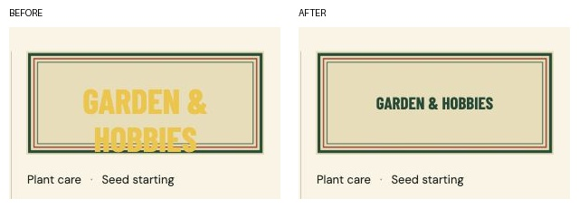

# Spacing and overlap follow-up

Result: **passed for the checked views and widths**, after fixing the custom cover overlap reported by the user. Evidence below was captured in this audit run from the synthetic local demo.

## Finding and correction

**P2 — Custom category text crossed the matchbox border.** The generic `.art > span` fallback rule had greater specificity than the custom label rule. It supplied a 38 px font, extra padding, yellow color and an aspect ratio to the absolutely positioned custom label. At a 263 × 114 px cover, the label's box grew to about 124 px tall and crossed the frame.

Separated fallback and custom label styles. The cover now establishes its own aspect ratio and text sizing container; labels are inset, centered and bounded to two lines. The corrected 263 px cover uses about 19 px green text, fully inside its frame. At small 94 px covers the label uses 10 px text, while the full adjacent category heading remains readable. Long labels wrap or truncate within the frame, with the full category name available through navigation and the button's accessible name.

Also reserved consistent two-line caption space under home previews, allowed long category/subtopic text to reflow in narrow headings and filters, and corrected singular “1 save” labels.

## Checked steps

1. **Library home — passed.** Inspected the entire page, including all eight populated categories and the final Garden & Hobbies cover, rather than only the first row. Checked the original 622 px viewport and explicit 320, 390, 1024 and 1440 px widths. No horizontal overflow or controls outside the viewport. At 1440 px, the first-row preview tops align within 0.5 px and Browse all links within 1 px. [Full desktop capture](visual-audit/library-desktop.jpg), [phone capture](demo-phone.jpg).
2. **Collections and search — passed.** Checked Garden & Hobbies, subcategory controls and recipe search on phone widths. No clipped headings, filter overlaps or horizontal overflow. A 77-character unbroken category name also reflowed within a 320 px screen; the cover label stayed inside its frame. Restored the original synthetic category name afterwards. [Collection](visual-audit/collection-phone.jpg), [search](visual-audit/search-phone.jpg).
3. **Item details — passed.** Checked normal and long-category item dialogs at 320 px. Dialog scrollWidth equals clientWidth (280 px); actions wrap, headings stay inside the dialog, and the close control remains separate. Vertical scrolling is intentional. [Detail capture](visual-audit/detail-phone.jpg).
4. **Settings and page end — passed.** Checked import counts, export link and category management fields at 320 px without horizontal overflow. Scrolled to the actual page end and confirmed the final preview title ends about 97 px above the fixed navigation. Full-page screenshots can place the fixed navigation at the original viewport position; the separate end-of-page capture verifies the actual scrolled state. [Settings](visual-audit/settings-phone.jpg), [page end](visual-audit/page-end-phone.jpg).

Final browser console error check: empty. Production build, 13 backend tests, 10 manager/release tests and four Sites tests pass. Both distribution ZIPs are rebuilt with the correction and refreshed public demo screenshots.

This confirms the observed layouts in the available in-app browser. It is not a full accessibility certification or a guarantee for every browser, font configuration or future content. No real Instagram capture was performed during this check.
